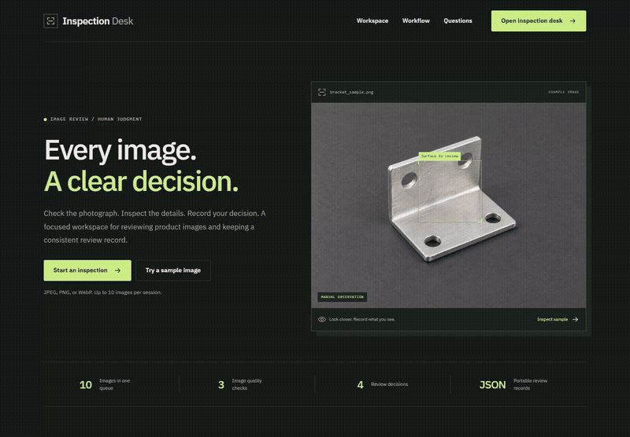

# Visual Inspection Desk

A workspace for reviewing product return photographs. Check image quality, document visible issues, choose a disposition and export a review record that another person can inspect.

[Open the app](https://visual-inspection-desk-production.up.railway.app) · [GitHub Actions](https://github.com/Swarneil1905/visual-inspection-desk/actions) · [MIT license](LICENSE)

## Watch the walkthrough

[](docs/assets/walkthrough.mp4)

[Watch or download the full video](docs/assets/walkthrough.mp4) (00:00:24.20) · [View a still screenshot](docs/assets/preview.png). This silent recording uses the built in sample photograph and the live image quality API. The inspection decision is made by the reviewer.

## Try it in a minute

1. Open the homepage and choose the sample inspection, or upload your own JPEG, PNG or WebP image.
2. Review resolution, exposure and edge detail beside the photograph.
3. Record what you can see, choose a decision and add a note.
4. Complete the review and select **Export reviews** to download the JSON records.

The sample is an illustrative image, not a labeled training example. Quality measurements help decide whether a photograph is usable; they do not establish whether a product is damaged.

## Current capabilities

| Feature | Behavior |
| --- | --- |
| Review queue | Up to 10 photographs in the current tab |
| Quality checks | Resolution, brightness and edge detail measured by the API and native engine |
| Human review | Observations, notes and accept, reject, escalate or retake decisions |
| Export | Completed JSON records without embedding photographs |
| Optional model | ONNX inference with validation checks and abstention support |

No validated defect model is loaded in the public app. Automated defect detection requires representative labeled images and validation. Photos and drafts stay in the current browser session; uploads are processed in server memory and are not saved by the API.

## How it works

```text
Angular interface → .NET API → C++ image quality measurements
                            → Optional ONNX defect inference
Python / PyTorch training → ONNX model + validation manifest
```

| Component | Responsibility |
| --- | --- |
| Angular | Image preview, observations, notes and JSON export |
| C# / .NET | Bounded uploads, image decoding and inference orchestration |
| C++ | Brightness and edge detail measurements |
| Python / PyTorch | Optional model training, evaluation and ONNX export |
| ONNX Runtime | Optional model inference within the API |

Uploads are limited to 10 MB and 20 megapixels. The API processes photographs in memory and does not save them. At most two inspections run concurrently.

## Quick start with Docker

Requires Docker Desktop or Docker Engine with Compose. From the repository root:

```sh
docker compose up --build
```

Open **http://localhost:8081**. Upload a photograph, review its quality, record observations and export the result. Stop the stack with `docker compose down`.

## Run without Docker on Windows

Requires .NET 10 SDK, Visual Studio C++ build tools and Node.js 22.22+.

From a Visual Studio **x64 Native Tools** terminal, enter the repository's `native` directory:

```bat
cl /EHsc /std:c++17 /LD quality.cpp /Fe:image_quality.dll
cl /EHsc /std:c++17 test_quality.cpp quality.cpp /Fe:quality_test.exe
quality_test.exe
```

From the repository root in PowerShell:

```powershell
dotnet build api/Inspection.Api.csproj -c Release
Copy-Item native/image_quality.dll api/bin/Release/net10.0/image_quality.dll
dotnet api/bin/Release/net10.0/Inspection.Api.dll
```

In a separate terminal:

```sh
cd frontend
npm ci
npm start
```

Open **http://localhost:4201**. The API listens on port **8001**. CMake is also supported for building and testing the native library; the Dockerfile and CI workflow show the Linux setup.

## Optional defect model

Install the training dependencies in a separate Python environment:

```powershell
python -m venv .venv
.venv\Scripts\python.exe -m pip install -r ml/requirements.txt
.venv\Scripts\python.exe ml/train.py --data data --output models --epochs 12
```

On macOS or Linux, use `.venv/bin/python` instead. Prepare this directory structure:

```text
data/
  train/       damaged/  intact/
  validation/  damaged/  intact/
  test/        damaged/  intact/
```

Each split contains two class directories. Split by physical item so that photographs of the same item do not cross between training, validation and test sets. The training script rejects byte identical files across splits but cannot detect every related photograph.

Training selects a checkpoint using validation accuracy, evaluates the held out test split, exports ONNX and checks numerical parity. The manifest passes its artifact gate only when:

- The test split has at least 20 examples per class.
- Precision is at least 0.9 per class at the 0.8 score threshold.
- Prediction coverage is at least 0.5.

These checks are not proof of production reliability or calibrated probabilities. Set `DEFECT_MODEL_PATH` to the absolute path of `defect.onnx` and keep `defect.json` beside it. The API checks the manifest and model hash, then abstains for poor image quality, incompatible orientation, low score or inference failure. Human review remains required.

The default Compose file does not mount a trained model. Add a model volume and `DEFECT_MODEL_PATH` when enabling inference in a container.

## API

| Method | Path | Purpose |
| --- | --- | --- |
| GET | `/api/health` | Service health |
| POST | `/api/inspection/quality` | Multipart image upload for quality checks and optional inference |

## Development checks

After installing the training dependencies:

```powershell
.venv\Scripts\python.exe -m pip install httpx
.venv\Scripts\python.exe -m pytest ml -q
# With the API running:
.venv\Scripts\python.exe -m pytest tests -q
cd frontend
npm run build
```

Native tests cover brightness, edges and invalid buffers. HTTP tests cover valid images, corrupt files, spoofed extensions and oversized images. Model tests cover export parity, duplicate data and abstention. GitHub Actions also builds the frontend, .NET API and containers.

The synthetic image at `tests/fixtures/calibration.png` is a quality test fixture, not training evidence. See the [verification notes](docs/verification.md) for test results and browser verification limits.

## Repository guide

| Path | Contents |
| --- | --- |
| `frontend/src/inspection.ts` | Image review and export workflow |
| `api/Program.cs` | Upload validation, native interop and optional inference |
| `native/` | C++ measurements, CMake configuration and tests |
| `ml/` | PyTorch training, export and model contract tests |
| `tests/` | HTTP integration tests and a synthetic image fixture |
| `docs/` | Architecture and verification details |

The public demo uses bounded uploads and a rate limited gateway. Representative dataset validation remains required for meaningful defect predictions. See [deployment and operations](docs/deployment.md).

## Deployment and availability

The homepage is at `/`; the product workspace is at `/workspace`. The public Railway service uses sleep mode to reduce idle hosting costs. The first visit after inactivity can take longer while the service starts. Public requests are rate limited.

GitHub Actions checks frontend and backend code, builds the containers, tests the public HTTP path, and verifies both process failure handling and a clean Docker shutdown. Only a verified current `main` commit is promoted to the `production` branch that Railway deploys. A normal platform stop exits successfully; an unexpected required process exit fails the container.

See [deployment and operations](docs/deployment.md) for configuration and rollback, and [architecture](docs/architecture.md) for the service boundaries.

## License

Original project code is licensed under the [MIT License](LICENSE), copyright © 2026 Swarneil Pradhan. Bundled fonts retain their SIL Open Font Licenses in [`frontend/public/fonts`](frontend/public/fonts). Third party dependencies retain their respective licenses.
